# How StoryShield Works

```mermaid
flowchart LR
    A[User logs in] --> B[Upload PDF]
    B --> C[Save file to uploads folder]
    C --> D[Extract PDF text]
    D --> E[Detect chapters]
    E --> F[Chunk chapters]
    F --> G[Store chunks in Chroma]
    G --> H[Reader opens PDF in app]
    H --> I[User asks question]
    I --> J[Retrieve only allowed context]
    J --> K[LLM answers spoiler-safely]
    K --> L[Return answer to frontend]
```

## Flow summary

- The backend stores the uploaded PDF and serves it back for viewing.
- PDF text is extracted and broken into chapter-aware chunks.
- Chroma indexes those chunks so the app can search the relevant book context.
- By default, the reading assistant only uses content available up to the user’s current chapter/page.
- Readers can explicitly enable future spoilers for an individual question; spoiler protection is on by default.
- The reader saves the selected chapter/page and opens the PDF at the bookmarked page on return.
- The library tracks books marked as read or pending and shows both totals.
- A separate summary section generates a spoiler-safe summary through the saved reading position.
- In spoiler-safe mode, the model answers without inventing plot details beyond that point; with spoilers enabled, it can use future book content.
