# How StoryShield Works

```mermaid
flowchart LR
    A[User logs in] --> B[Upload PDF]
    B --> C[Save file to uploads folder]
    C --> D[Extract PDF text]
    D --> E[Detect chapters]
    E --> F[Chunk chapters]
    F --> G[Store chunks in Chroma]
    G --> H[Reader opens PDF in app]
    H --> I[User asks question]
    I --> J[Retrieve only allowed context]
    J --> K[LLM answers spoiler-safely]
    K --> L[Return answer to frontend]
```

## Flow summary

- The backend stores the uploaded PDF and serves it back for viewing.
- PDF text is extracted and broken into chapter-aware chunks.
- Chroma indexes those chunks so the app can search the relevant book context.
- The reading assistant only uses content available up to the user’s current chapter/page.
- The model then answers without inventing plot details beyond that point.
